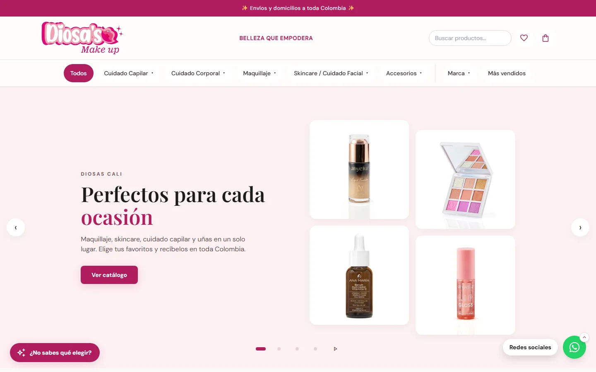

<p align="center">
  
</p>

<h1 align="center">Quimora Tech</h1>

<p align="center">
  <strong>Páginas web que convierten visitantes en clientes reales.</strong><br>
  Diseño y desarrollo web a medida desde Cali, Colombia.
</p>

<p align="center">
  <a href="https://quimoratech.com/#contacto"><strong>Solicitar cotización</strong></a> ·
  <a href="https://wa.me/573244577198?text=Hola%2C%20quiero%20m%C3%A1s%20informaci%C3%B3n%20sobre%20sus%20servicios"><strong>Escribir por WhatsApp</strong></a> ·
  <a href="https://quimoratech.com/#showcase"><strong>Ver Casos de Éxito</strong></a>
</p>

---

Tu negocio merece algo más que estar en internet. En Quimora Tech creamos sitios web rápidos,
pensados primero para el celular y hechos para que quien te visita termine escribiéndote,
agendando o comprando. Sin dolores de cabeza técnicos: tú nos cuentas qué necesitas y nosotros
nos encargamos del resto.

## Para quién trabajamos

- Tiendas físicas y virtuales
- Restaurantes, cafeterías y bares
- Clínicas, consultorios y academias
- Hoteles, inmobiliarias y talleres
- Empresas medianas, emprendedores y profesionales independientes

Nos enfocamos especialmente en los negocios locales de Cali y del Valle del Cauca.

## Qué podemos construir para ti

| Área             | Para qué sirve                                                              | Soluciones                                                                                                                                                  |
| ---------------- | --------------------------------------------------------------------------- | ----------------------------------------------------------------------------------------------------------------------------------------------------------- |
| **Web y ventas** | Que te encuentren, te escriban y te compren a cualquier hora.               | Sitios web corporativos · Landing pages · Tiendas online · Reservas y citas                                                                                 |
| **Gestión**      | Ordenar tu operación: inventario, ventas, caja y clientes en un solo lugar. | Sistemas administrativos · Paneles de gestión · Sistemas de inventario · Control de ventas, caja y cotizaciones · Portales para clientes                    |
| **A medida**     | Tecnología hecha para tu negocio.                                           | Plataformas web personalizadas · Automatización de procesos · Integraciones con APIs · Soluciones con inteligencia artificial · Aplicaciones web escalables |

## Cómo trabajamos

| Cuándo      | Etapa                    | Qué pasa                                                                   |
| ----------- | ------------------------ | -------------------------------------------------------------------------- |
| Semana 1    | **Diagnóstico**          | Escuchamos tus metas, analizamos tu competencia y definimos la estrategia. |
| Semanas 2–3 | **Desarrollo**           | Diseñamos y desarrollamos tu web, optimizada desde el inicio.              |
| Semana 4    | **Lanzamiento**          | Tu web sale a producción y tus clientes ya pueden verla y contactarte.     |
| Después     | **Crecimiento continuo** | Medimos, optimizamos y seguimos mejorando.                                 |

## Un proyecto real: Diosa's Make up

<p align="center">
  
</p>

Tienda online de maquillaje y cuidado capilar con **más de 850 productos** en su catálogo, menú
por categorías y marcas, buscador, favoritos, carrito con pedido por WhatsApp y compra al detal
o al por mayor. La dueña administra precios, existencias, fotos y reseñas desde su propio panel.
La tienda aún no está publicada.

Mostramos solo trabajo real: aquí no encontrarás testimonios ni cifras inventadas.

## Planes

| Plan            | Inversión de referencia        | Ideal para                                                                      |
| --------------- | ------------------------------ | ------------------------------------------------------------------------------- |
| **Emprendedor** | Desde $450.000 COP, pago único | Poner tu negocio en línea con catálogo y un canal directo para recibir pedidos. |
| **Presencia**   | Desde $650.000 COP, pago único | Tener una presencia profesional que atraiga clientes y genere contactos.        |
| **Crecimiento** | Desde $950.000 COP, pago único | Un sitio completo con más secciones, más control y más datos para vender mejor. |
| **A Medida**    | Cotización personalizada       | Tiendas en línea, sistemas de reservas o integraciones específicas.             |

Los planes Emprendedor, Presencia y Crecimiento incluyen hosting por 3 meses y dominio. Estos
valores son orientativos: el alcance y el precio final se confirman por escrito en tu cotización.

## Lo que puedes esperar de nosotros

- **Pensado para el celular:** diseño responsive desde el primer día.
- **Velocidad como objetivo:** buscamos cargas de menos de 3 segundos y una meta de 95+ en
  Google Lighthouse.
- **Buenas prácticas de SEO** desde el inicio.
- **Conexión con WhatsApp** para que tus clientes te escriban sin fricción.
- **Respuesta a tu mensaje en 24 horas.**
- **Entrega de accesos y archivos** del proyecto, y acompañamiento durante el lanzamiento.

## ¿No sabes por dónde empezar?

Responde cinco preguntas en unos 2 minutos y recibe gratis una recomendación según tu negocio.
Es una orientación, sin compromiso.

**[Comenzar diagnóstico gratuito](https://quimoratech.com/#diagnostico)**

## Hablemos

- **Web:** [quimoratech.com](https://quimoratech.com)
- **WhatsApp:** [+57 324 457 7198](https://wa.me/573244577198?text=Hola%2C%20quiero%20m%C3%A1s%20informaci%C3%B3n%20sobre%20sus%20servicios)
- **Correo:** [devopsconsultoring@gmail.com](mailto:devopsconsultoring@gmail.com)
- **Ubicación:** Cali, Colombia

---

<details>
<summary><strong>Para quienes trabajan en este código</strong></summary>

Este repositorio contiene el sitio [quimoratech.com](https://quimoratech.com), construido con
TanStack Start (React 19), Vite, TypeScript, Tailwind CSS v4, Nitro y Cloudflare Workers.

```bash
npm install
npm run dev        # http://localhost:8080
```

| Comando            | Qué hace                         |
| ------------------ | -------------------------------- |
| `npm run dev`      | Servidor de desarrollo           |
| `npm run build`    | Build de producción (`.output/`) |
| `npx tsc --noEmit` | Comprobación de tipos            |
| `npm run lint`     | ESLint                           |
| `npm run format`   | Prettier                         |

- [`docs/ESTRUCTURA.md`](docs/ESTRUCTURA.md): carpetas, rutas, componentes, datos y despliegue.
- [`.specify/memory/constitution.md`](.specify/memory/constitution.md): reglas obligatorias para todo cambio.
- [`CLAUDE.md`](CLAUDE.md): identidad visual y estándares de código.
- [`docs/PLANTILLA_CASO_DE_EXITO.md`](docs/PLANTILLA_CASO_DE_EXITO.md): plantilla para documentar proyectos reales.

</details>
